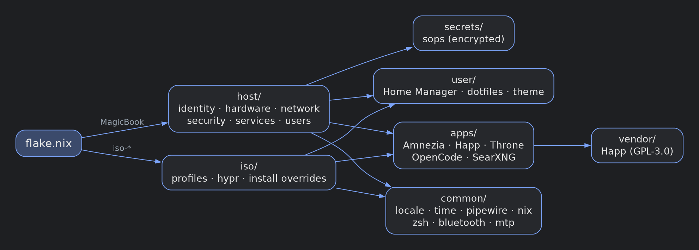
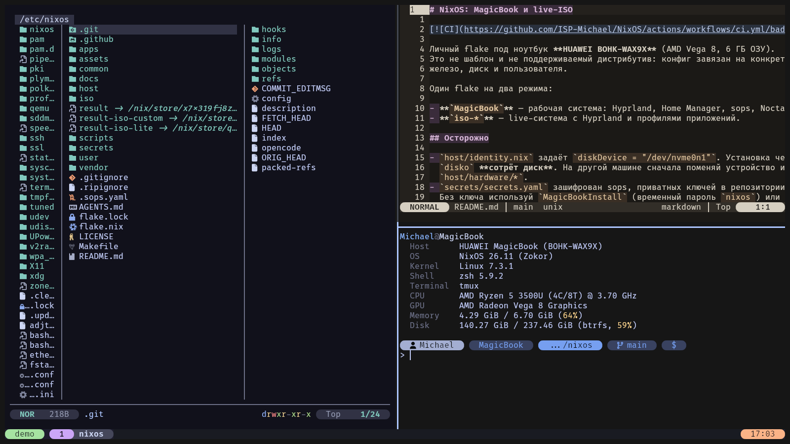

# NixOS: MagicBook и live-ISO

[](https://github.com/ISP-Michael/NixOS/actions/workflows/ci.yml)

Личный flake под ноутбук **HUAWEI BOHK-WAX9X** (AMD Vega 8, 6 ГБ ОЗУ).
Это не шаблон и не поддерживаемый дистрибутив: конфиг завязан на конкретное
железо, диск и пользователя.

Один flake на два режима:

- **`MagicBook`** — рабочая система: Hyprland, Home Manager, sops, Noctalia.
- **`iso-*`** — live-система с Hyprland и профилями приложений.

## Осторожно

- `host/identity.nix` задаёт `diskDevice = "/dev/nvme0n1"`. Установка через
  `disko` **сотрёт диск**. На другой машине сначала поменяй устройство и
  `host/hardware/*`.
- `secrets/secrets.yaml` зашифрован sops, приватных ключей в репозитории нет.
  Без ключа используй `MagicBookInstall` (временный пароль `nixos`) или добавь
  host-ключ, см. `docs/secrets.md`.

## Требования

- **x86_64 UEFI.** ARM и NVIDIA не поддерживаются; для live-ISO Secure Boot
  нужно выключить (или зарегистрировать ключ Ventoy).
- **NixOS 26.11** и `nix` с flakes. Хост проверен на 6 ГБ ОЗУ и AMD Vega 8.
- Для установки на другую машину нужен свой `host/hardware` и правка
  `diskDevice`; `MagicBook` — не универсальный профиль.

## Быстрый старт

```bash
git clone https://github.com/ISP-Michael/NixOS.git
cd NixOS

make check       # быстрая проверка хоста и dotfiles
make ci          # полная: 7 конфигураций и 5 ISO (для CI)
make switch      # собрать и активировать MagicBook (спросит sudo)
make build-iso   # собрать iso-custom в result-iso-custom
make status      # состояние manual-частей
```

`make check` не требует чистого дерева, `make ci` требует. Полная проверка
тяжёлая — её штатное место GitHub Actions, локально достаточно `make check`.
Пока запущена игра, проверки и сборки не стартуют; осознанный обход —
`ALLOW_GAMING=1`.

## Структура

| Каталог | Что внутри |
|---|---|
| `apps/` | Ручные и `/opt`-приложения: Amnezia, Happ, Throne, OpenCode, SearXNG. На хосте — официальные версии, на ISO — pinned. |
| `common/` | Переносимый слой: локаль, время, PipeWire, nix, appimage, nix-ld, zsh, bluetooth, MTP. |
| `host/` | Только MagicBook: identity, железо, диск, сеть, безопасность, сервисы, пользователи, Home Manager. |
| `iso/` | Live-система: профили, Hyprland, копия репозитория в `/etc/nixos`, установочные overrides. |
| `user/` | Home Manager: база, XDG, пакеты, программы, тема, dotfiles. |
| `vendor/` | Сторонний код со своей лицензией (`vendor/happ`, GPL-3.0). |
| `secrets/` | Зашифрованные sops-секреты и пример снимка. Приватные ключи сюда не кладутся. |
| `scripts/` | Проверки, деплой, пуш, статус, обслуживание. |
| `docs/` | Архитектура, решения, ISO, секреты, перенос, операции. |
| `assets/` | Картинки и обои; видео игнорируются git. |



## ISO

Профили — `iso-lite`, `iso` (work), `iso-custom`, `iso-media`, `iso-full`.
`custom` — основной: Hyprland, Firefox, LibreOffice, Telegram, KeePassXC,
OpenCode, AmneziaVPN и Happ. В меню только Firefox; Chromium — обёртка для
Playwright MCP.

Live-система работает без установки, но с неё же можно поставить систему:
репозиторий лежит в `/etc/nixos`. Steam, Blender, Docker и виртуалки в ISO
не входят. Запись на флешку и установка — `docs/iso.md`.

## Интерфейс и клавиатура

Hyprland + Noctalia, конфиги — `user/dotfiles/.config` (симлинки в репозиторий).



На снимке — kitty, tmux, yazi, nvim, fastfetch и zsh с конфигами из репозитория.
Снято в отдельной headless-сессии, без личных окон.

Слои клавиатуры настраиваются keyd:


Короткий тап по Alt включает слой навигации/символов, удержание — обычный
Alt; CapsLock по тапу даёт Ctrl. Полные схемы и таблицы — `docs/keyd.md`.

## Документация

- [`docs/architecture.md`](docs/architecture.md) — карта репозитория и границы слоёв.
- [`docs/ai.md`](docs/ai.md) — компактный контекст для ИИ-агента.
- [`docs/conventions.md`](docs/conventions.md) — стиль Nix и именование.
- [`docs/decisions.md`](docs/decisions.md) — что выключено и почему.
- [`docs/iso.md`](docs/iso.md) — профили, сборка, установка, live-поведение.
- [`docs/keyd.md`](docs/keyd.md) — слои клавиатуры и схемы.
- [`docs/keybinds.md`](docs/keybinds.md) — горячие клавиши Hyprland.
- [`docs/hyprland.md`](docs/hyprland.md) — окна, диспетчеры, темы.
- [`docs/hardware.md`](docs/hardware.md) — железо MagicBook и проверки.
- [`docs/fastfetch.md`](docs/fastfetch.md), [`docs/kitty.md`](docs/kitty.md),
  [`docs/nvim.md`](docs/nvim.md), [`docs/tmux.md`](docs/tmux.md),
  [`docs/yazi.md`](docs/yazi.md), [`docs/zsh.md`](docs/zsh.md) — конфиги.
- [`docs/secrets.md`](docs/secrets.md) — sops, ключи, новые машины.
- [`docs/manual-apps.md`](docs/manual-apps.md) — `/opt`-приложения и проверка.
- [`docs/transfer.md`](docs/transfer.md) — перенос OpenCode/OpenClaw.
- [`docs/operations.md`](docs/operations.md) — проверки, деплой, git.
- [`docs/new-machine.md`](docs/new-machine.md) — новая машина.

## Ограничения

- ISO — live-режим без persistence; для установки нужен `disko`, а не
  «одна кнопка».
- Полный `make ci` на 6 ГБ не предназначен для повседневного запуска:
  он для GitHub Actions.
- Секреты и приватные ключи в репозитории отсутствуют; без ключа ставится
  только `MagicBookInstall`.

## Лицензия

[Unlicense](LICENSE). `vendor/happ` — GPL-3.0, см. `vendor/happ/LICENSE`.
