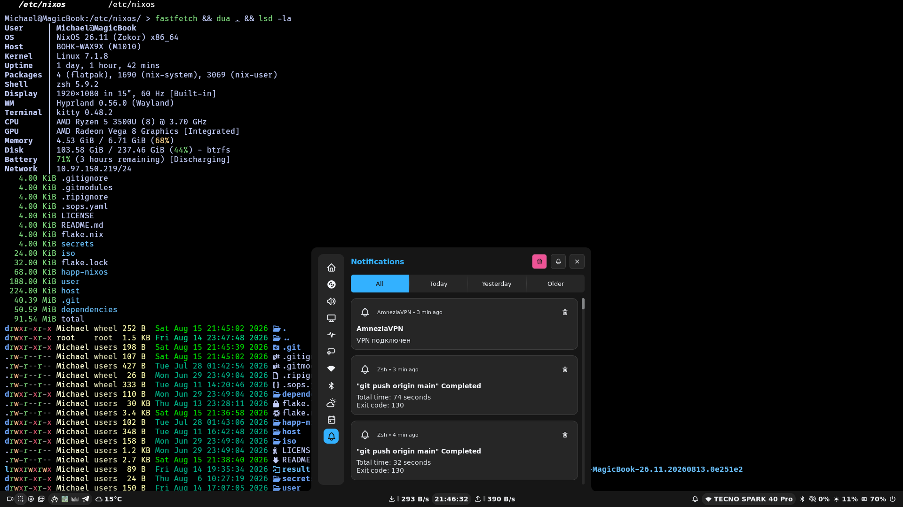
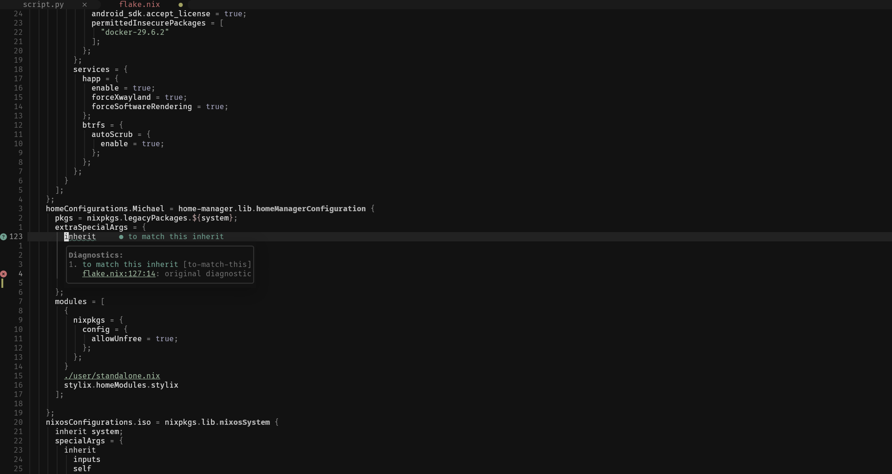

# NixOS: MagicBook и live-ISO

Один flake на два режима:

- **`MagicBook`** — обычная система на ноутбуке (Hyprland, Home Manager, sops);
- **`iso-*`** — live-система с Hyprland и профилями приложений.

## Быстрые команды

```bash
cd /etc/nixos

# проверить всё
make check

# пересобрать хост (спросит sudo)
make switch

# собрать live-ISO
make build-iso

# здоровье manual-частей
make status
```

## Структура

| Каталог | Что внутри |
|---|---|
| `apps/` | Ручные/`/opt`-приложения: Amnezia, Happ, Throne, OpenCode, SearXNG. Host — официальные версии, ISO — pinned. |
| `common/` | Переносимый системный слой: локаль, время, PipeWire, nix, appimage, nix-ld, zsh, bluetooth, MTP. Используется и хостом, и ISO. |
| `host/` | Только MagicBook: identity, железо, диск, сеть, безопасность, сервисы, пользователи, Home Manager. Точка входа — `host/default.nix`. |
| `iso/` | Live-система: профили, Hyprland, копия репозитория в `/etc/nixos`, установочные overrides. Точка входа — `iso/default.nix`. |
| `user/` | Home Manager: `default.nix` → база, XDG, пакеты, программы, тема, dotfiles. |
| `vendor/` | Сторонний код с собственной лицензией (`vendor/happ`). |
| `secrets/` | Зашифрованные sops-секреты и пример снимка. Приватные ключи сюда не кладутся. |
| `scripts/` | `ci.sh`, `deploy.sh`, `push.sh`, `status.sh`. |
| `docs/` | Архитектура, правила, ISO, секреты, ручные приложения, перенос, операции. |
| `assets/` | Картинки и обои; видео игнорируются git. |

## Документация

- [`docs/architecture.md`](docs/architecture.md) — карта репозитория и границы слоёв.
- [`docs/ai.md`](docs/ai.md) — компактный контекст для ИИ-агента.
- [`docs/conventions.md`](docs/conventions.md) — стиль Nix и правила именования.
- [`docs/decisions.md`](docs/decisions.md) — что выключено/удалено и почему.
- [`docs/iso.md`](docs/iso.md) — профили, сборка, установка, live-поведение.
- [`docs/secrets.md`](docs/secrets.md) — sops, ключи, новые машины.
- [`docs/manual-apps.md`](docs/manual-apps.md) — `/opt`-приложения и их проверка.
- [`docs/transfer.md`](docs/transfer.md) — перенос OpenCode/OpenClaw на другую машину.
- [`docs/operations.md`](docs/operations.md) — проверки, деплой, пуш, git.
- [`docs/new-machine.md`](docs/new-machine.md) — новая машина, железо, sops.

## Что важно

- На ISO в меню только **Firefox**; Chromium — обёртка для Playwright MCP OpenCode.
- OpenCode 2.3.0, AmneziaVPN 5.1.0.6 и Happ 4.7.2 входят в `work`/`custom`/`media`/`full`.
- Steam, Blender, Docker, виртуалки в live-ISO не тащим.
- `MagicBookInstall` — тот же хост без sops и с временным паролем `nixos`; нужен только для установки без ключа.
- Пароль пользователя и `secrets/apps.yaml` — через sops; сборка ключ не требует.

## Скриншоты





## Лицензия

[Unlicense](LICENSE). `vendor/happ` — GPL-3.0, см. `vendor/happ/LICENSE`.
