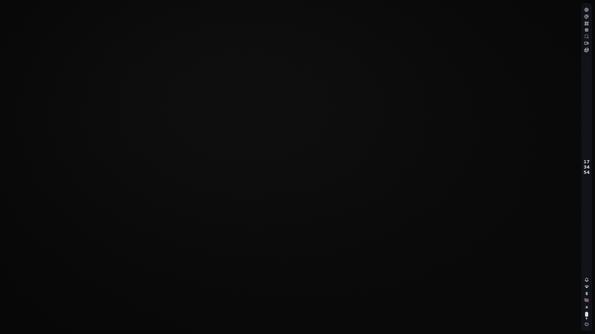

# Hyprland

Рабочий стол: чёрные обои, вертикальный бар Noctalia справа, окна с отступами
и скруглением 10.



Конфиг живёт в двух местах:

- `user/dotfiles/.config/hypr/` — вход хоста и общие модули;
- `iso/config/hypr/` — вход live-ISO, live-профиль и live-автостарт.

## Композиция

```text
iso/config/hypr/hyprland.lua ─┐
                              ├─→ manifest.lua
user/dotfiles/.../hyprland.lua ┘      ├─→ settings/   (декларативные настройки)
                                      ├─→ rules/      (window/layer rules)
                                      └─→ binds/      (клавиши по доменам)

host entry → manifest + monitors.lua + autostart.lua
iso entry  → manifest + autostart.lua (ISO)
```

`manifest.lua` — единственный список общих модулей. Если добавляется новый
файл в `settings/`, `rules/` или `binds/`, он добавляется туда один раз.

`profile.lua` — единственное место, где расходятся значения общих модулей:
файловый менеджер, команды, пути и геометрия окон. Общие модули читают его
через `require('profile')`. Системные входы отдельно добавляют свои
`monitors.lua` и `autostart.lua`. ISO-вход ставит `iso/config/hypr` первым в
`package.path`, поэтому `require('profile')` и `require('autostart')`
резолвятся в ISO-файлы, а не в хостовые.

## Куда добавлять

| Задача | Файл |
|---|---|
| Новый декларативный блок (`hl.config`, curve/animation, gesture) | `settings/<name>.lua` + `manifest.lua` |
| Новая клавиша | `binds/<домен>.lua`; новый файл — в `manifest.lua` |
| Новое правило окна | `rules/windows.lua` |
| Новый файловый диалог | `rules/file-dialogs.lua` |
| Новое layer-правило | `rules/layers.lua` |
| Команда/путь/размер только для хоста | `profile.lua` |
| Команда/путь/размер только для ISO | `iso/config/hypr/profile.lua` |
| Приложение в автостарт хоста | `autostart.lua` |
| Приложение в автостарт ISO | `iso/config/hypr/autostart.lua` |

В `binds/` и `rules/` не должно быть `hl.config`; в общих модулях не должно
быть `/home/Michael` и других хостовых путей.

## Monocle

В monocle есть ровно две layout-команды: `cyclenext` и `cycleprev`.
`SUPER + стрелки`, `SUPER + ,` / `SUPER + .` и `Alt+Tab` вызывают их.
Стрелки не могут двигать фокус вбок: `moveTargetInDirection()` ищет только
другой монитор, а у ноутбука он один (`eDP-1`). Поэтому все четыре стрелки
циклически переключают окна.

Ресайз с клавиатуры (`SUPER+SHIFT+h/j/k/l`) работает только на плавающих
окнах: monocle перезаписывает размер тайлового окна при каждом пересчёте.

## Permissions

`permissions.lua` включает `ecosystem.enforce_permissions = true`. При этом
любой клиент без правила уходит в ask-диалог. Правила применяются при
перезапуске Hyprland, не при `hyprctl reload`.

`hl.permission()` матчит regex по каноническому `/proc/<pid>/exe`
(`RE2::FullMatch` по всему пути). В Nix многие бинарники — обёртки:
реальный файл называется `.<name>-wrapped`, а `/etc/profiles` разворачивается
в `/nix/store/<hash>-<name>`. Поэтому в правилах есть `[^/]*` и
`\.?name(-wrapped)?`.

## Файловые диалоги

Hyprland склеивает поля `match` через AND, поэтому «класс портала ИЛИ
заголовок приложения» нельзя выразить одной записью. В `rules/file-dialogs.lua`
две записи:

1. `file-dialog-portal` — класс портала. На хосте FileChooser обслуживает
   KDE-портал (`host/desktop/hyprland.nix`), на ISO — GTK
   (`iso/desktop.nix`); regex покрывает оба.
2. `file-dialog-native` — приложения, которые рисуют диалог сами; их можно
   отличить только по заголовку. Список английский, потому что локаль
   `en_US.UTF-8`.

`kdialog-picker` — отдельный случай: Neovide вызывает `kdialog` для выбора
папки проекта, это не портал и не native chooser приложения.

## Производительность

- **Blur выключен.** `kawase`, size 6, passes 1 — самый дешёвый вариант, но
  на Vega 8 дополнительный проход всё равно дороже пользы. Анимированные
  варианты (`ripple`, `drops`, `water`, `fluid_jar`, `heat_shimmer`,
  `aurora`) считаются каждый кадр.
- **Shadows выключены.** Квад тени — окно + `2*range` по каждой стороне,
  заливается фрагментным шейдером. При `border_size = 0` плавающие окна
  разделяются только скруглением. Если разделение понадобится, 2px рамка
  дешевле тени: `general.border_size = 2` + `col.active_border`.
- **`direct_scanout = false`.** С ним полноэкранные Wayland-клиенты (mpv,
  виртуалки) показывали чёрный экран. Перепроверить после обновления
  Hyprland.
- **`async_commit = true`** (0.57) — композитор готовит следующий кадр, не
  дожидаясь предыдущего output-коммита.
- **`AQ_NO_MODIFIERS=1`** — отключает DRM buffer modifiers в Aquamarine;
  обходной путь для этого GPU.

## Проверка

```bash
Hyprland --verify-config -c /etc/nixos/user/dotfiles/.config/hypr/hyprland.lua
Hyprland --verify-config -c /etc/nixos/iso/config/hypr/hyprland.lua

# или
make hypr-check
```

`--verify-config` разбирает оба входа без запуска композитора и возвращает
ненулевой код при ошибке. `luac -p` проверяет только синтаксис, поэтому его
недостаточно.

На 6 ГБ не запускать полный `make ci`/`make check` при открытых Firefox,
Electron или OpenClaw: `nix eval` уходит в swap и может задушить Hyprland.
Для правок конфига достаточно `make hypr-check`.
