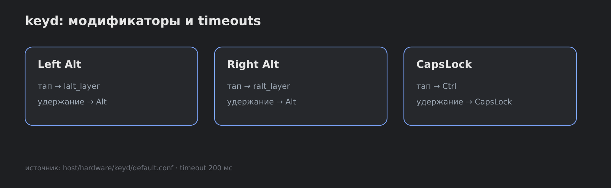
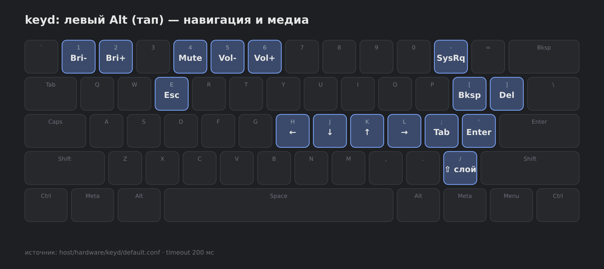
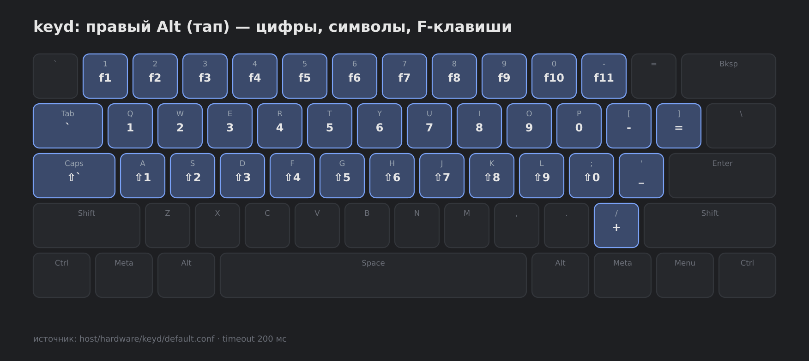
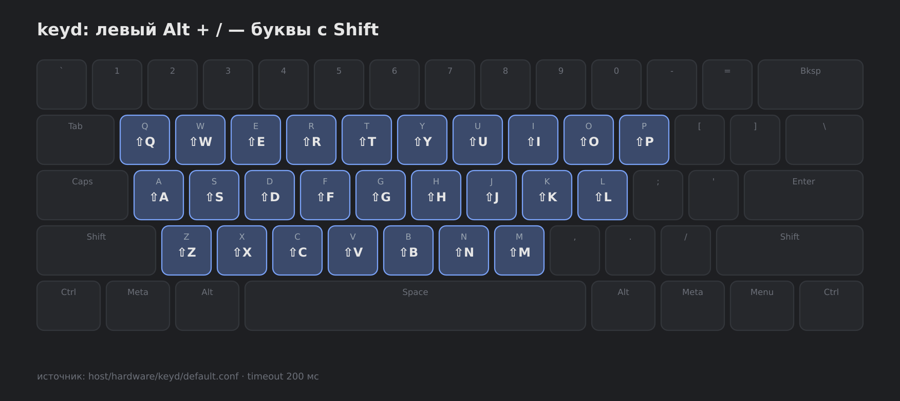

# keyd: слои клавиатуры

keyd **2.6.0**. Конфиг — `host/hardware/keyd/default.conf`, ставится в
`/etc/keyd/default.conf` через `environment.etc`; сервис перезапускается при
изменении файла (`host/hardware/keyd/default.nix`).

## Модификаторы



- **Left Alt / Right Alt** — короткий тап (до 200 мс) включает слой,
  удержание работает как обычный Alt.
- **CapsLock** — короткий тап даёт Ctrl, удержание — CapsLock.

В `timeout(A, 200, B)` первый аргумент — быстрый тап, второй — удержание.
В тексте мануала keyd порядок описан наоборот; проверено по исходникам
(`src/keyboard.c`, `handle_pending_timeout`).

## Слои

### `lalt_layer` — навигация и медиа



- `h` `j` `k` `l` — стрелки;
- `e` — Esc, `[` — Backspace, `]` — Delete, `'` — Enter, `;` — Tab;
- `1`/`2` — яркость, `4` — mute, `5`/`6` — громкость;
- `-` — SysRq;
- `/` — включает `lalt_shift`.

### `ralt_layer` — цифры, символы, F-клавиши



- `Tab` → `` ` ``, `q`…`p` → `1`…`0`, `[` → `-`, `]` → `=`;
- `CapsLock` → `~`, `a`…`;` → `!`…`)`, `'` → `_`, `/` → `+`;
- `1`…`0` → F1…F10, `-` → F11, `=` → F12.

### `lalt_shift` — буквы с Shift



Включается клавишей `/` внутри `lalt_layer`: `a`…`z` дают заглавные буквы.
Нужен, чтобы не тянуться к Shift при наборе заголовков и кода.

## Проверка и правка

```bash
# синтаксис до перезагрузки сервиса
keyd check host/hardware/keyd/default.conf

# применить (нужен root)
sudo keyd reload

# посмотреть, какие слои активны
keyd listen
```

`keyd list-keys` печатает допустимые имена клавиш, `keyd monitor` — поток
событий. После правки конфига — `git add host/hardware/keyd/default.conf` и
`make check`; схемы пересобираются скриптом:

```bash
python3 scripts/keyd-diagrams.py
for f in docs/images/keyd-*.svg; do
  inkscape "$f" --export-type=png --export-dpi=144 \
    --export-filename="${f%.svg}.png"
done
```
