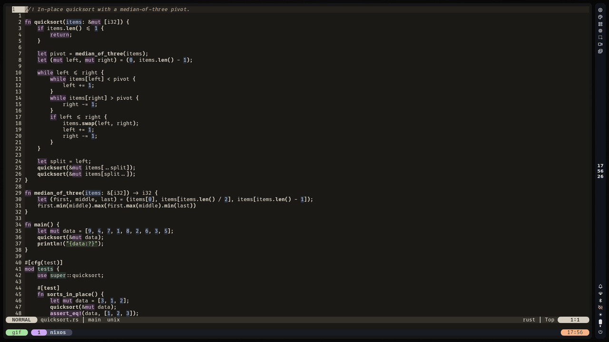
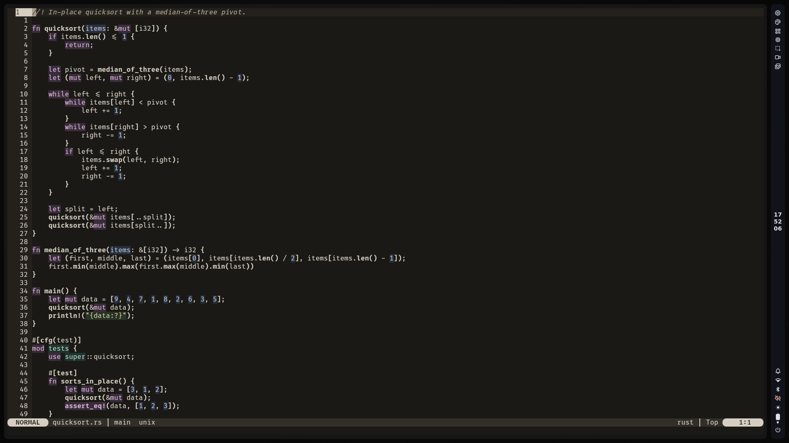

# Neovim

`~/.config/nvim` is a symlink to `user/dotfiles/.config/nvim`. Neovim is
0.13 nightly, plugin management is native `vim.pack`.

Демонстрация — прокрутка Rust-файла [`docs/demo/quicksort.rs`](demo/quicksort.rs):



[MP4 для mpv](images/demo-nvim.mp4) — качество лучше, чем у GIF.



## Bootstrap

```text
init.lua
├── providers off, vim.loader.enable(), vim._core.ui2
├── pack.setup()          # specs registered, no rtp/plugin source
├── core/{options,syntax,indent,keymap,diagnostic,completion,python}
├── core.project.setup() + core.neovide.setup() (Neovide only)
├── autocmds.templates
├── plugins               # manifest: loaders/keymaps/autocmds only
└── colorscheme flatblack # flat.theme.apply
```

`vim.pack.add(..., { load = function() end })` is load-bearing: it keeps every
plugin off `runtimepath`. `P.load` is plain `:packadd` (sources `plugin/`),
`P.runtime` is `:packadd!` (adds queries/parser/lsp/syntax only), `P.use` runs
the registered loader. `:PackLoadAll` is for benchmarks and tests.

## Layout

| Path | Responsibility |
|---|---|
| `lua/core/` | editor primitives; no third-party plugin setup |
| `lua/plugins/` | plugin lifecycle, keymaps, autocmds, triggers |
| `lua/pack.lua` | vim.pack API and the 32 specs |
| `lua/flat/theme/` | theme sections: ui, diagnostics, syntax, treesitter, lsp, plugins, terminal |
| `lua/flat/{cursor,strings}.lua` | cursor colour and multi-line string fill |
| `colors/`, `lua/lualine/themes/` | fixed lookup paths; do not move |
| `after/`, `queries/` | fixed runtime lookup paths |

The theme is split by section; `lua/flat/theme.lua` is only a compatibility
entry. Indent-guide groups live in `lua/flat/theme/plugins/indent.lua`; dead
Lazy groups stay removed.

Indent guides use two small plugins, as before the vim.pack refactor:
`indent-blankline.nvim` draws the static `│` lines at every indent level, and
`mini.indentscope` highlights the block the cursor is in. Both load after
`UIEnter`; ibl's `setup()` refreshes every existing window, so the first buffer
is covered too.

While a visual/select mode is active, ibl keeps the guide characters and
rewrites their highlight groups per selected line: the glyph keeps its normal
guide colour, while the cell background becomes the selection background
(`IblIndentSelected`/`IblScopeSelected` with `bg = base1`); spaces between
the lines use `IblWhitespaceSelected` (reversed Normal). The whole indent area
stays light, with visible vertical lines instead of black blocks.
`mini.indentscope` is hidden only inside the selection, because its line
would cover the ibl guide at the same column; it returns on exit.

`flatblack` uses `Visual = { reverse = true }`, which swaps fg/bg of each
token separately; a literal fg/bg swap for guides produced a dark block, not
a highlighted line. This is an experiment: set `selection_mode = 'hide'` at
the top of `lua/plugins/indent.lua` to restore the old full-hide behaviour.

## Plugin triggers

- first file → `nvim-lspconfig` runtime + `core.lsp` setup;
- matching filetype → tree-sitter parsers/textobjects, autotag, dbee, vim-nix;
- first buffer in `.git` → gitsigns;
- `InsertEnter` → autopairs;
- `UIEnter` + schedule → surround, neoscroll, indent guides (ibl + mini.indentscope), langmapper;
- first notification → snacks notifier;
- keys → fzf-lua, neo-tree, DAP, Spectre, Trouble, LazyGit, transparent;
- `BufWritePre` py/go → conform.

`vim-easy-align` is added to `runtimepath` during init and sourced by the normal
startup pass; it has no loader, so `PackLoadAll` does not include it.

## Recent cleanup

- `core/py.lua` → `core/python.lua`.
- `plugins/deps.lua` → `plugins/dependencies.lua` + `plugins/vim-nix.lua`.
- `plugins/run.lua` split into `toggleterm.lua`, `code-runner.lua` and the
  `RunCode` action.
- `autocmds/{python_template,typescript_template}.lua` → one table-driven
  `autocmds/templates.lua`.
- count-aware `o`/`O` restored as `core/repeat-o.lua` (the old lazy config
  required `core.O_o`; the vim.pack refactor dropped the require);
- dead `queries/nix/injections.scm` removed.
- dead tree-sitter `bad_maps` deletion and duplicate loader registration
  removed.
- lualine setup moved from `init.lua` into the plugin manifest.
- dead theme plugin groups and unused palette keys removed; indent-guide groups
  restored in `theme/plugins/indent.lua`.
- `after/syntax/gitignore.vim` links are re-applied on `ColorScheme`.

`core/completion.lua`, `core/lsp.lua` and `core/project.lua` are still large.
They are deliberately not split blindly: completion owns a PUM state machine,
LSP owns server config/attach, project owns Neovide/KDE selection. Split pure
helpers first and test headless; see the audit notes in the commit history.

## Validation

```bash
cd /etc/nixos/user/dotfiles/.config/nvim

# syntax (Neovim's LuaJIT is authoritative; luac is only a rough check)
find . -name '*.lua' -print0 | xargs -0 -n1 luac -p

# modules without sourcing plugins
nvim --headless -u NONE -i NONE -n \
  --cmd 'set runtimepath^=.' \
  +'lua for _,m in ipairs({"pack","core.options","core.syntax","core.indent","core.keymap","core.diagnostic","core.completion","core.python","core.project","core.neovide","core.lsp","core.treesitter","plugins","plugins.lualine","flat.theme","flat.cursor","flat.strings","flat.lualine","flat.black","flat.white","autocmds.templates"}) do local ok,e=pcall(require,m); if not ok then print("FAIL",m,e) end end' \
  +qa!

# both themes and lualine lookup
nvim --headless -u NONE -i NONE -n --cmd 'set runtimepath^=.' \
  +'colorscheme flatblack' +'lua assert(vim.g.colors_name=="flatblack")' +qa!
nvim --headless -u NONE -i NONE -n --cmd 'set runtimepath^=.' \
  +'colorscheme flatwhite' +'lua assert(vim.g.colors_name=="flatwhite")' +qa!

# full init (plugins installed)
nvim --headless -u ./init.lua -i NONE -n +'lua print(vim.g.colors_name, vim.o.background)' +qa!
```

`bench.sh` is headless; default `N=7`, use `N=13 ./bench.sh` to reproduce the
README numbers. Do not edit `nvim-pack-lock.json` by hand; the `'v3.x'` value
is vim.pack's normal serialization of a literal ref.
