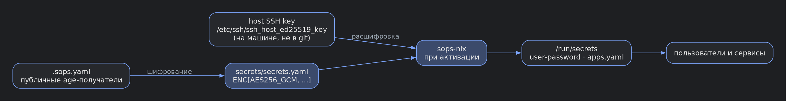

# Ключи sops: сборка, перенос, новые машины

Проверено 18.11.2026. Это **не** хранилище ключей, а инструкция. Приватные
ключи сюда не писать.

## TL;DR

- `nix build`, `nixos-rebuild build`, `nix flake check` — ключ **не нужен**.
  Секреты sops-nix расшифровываются только при активации/установке.
- `nixos-rebuild switch`, `nixos-install`, загрузка — нужен ключ, который
  может расшифровать `secrets/secrets.yaml`.
- Сейчас рабочий ключ — host-ключ MagicBook. Он же превращается sops-nix
  в `/run/secrets-for-users.d/age-keys.txt` (root, 0600).
- Для новой машины **не копируй host-ключ**: добавь её публичный host-age
  в `.sops.yaml` и сделай `sops updatekeys` с MagicBook.
- Для Windows/macOS ключ — обычный файл age; NixOS собирается только на
  Linux (на Windows — WSL2, на macOS — Linux-builder/VM).

## Как это работает



1. `.sops.yaml` — это **политика**, не секрет. В нём перечислены публичные
   age-получатели (admin, host MagicBook, host новой машины).
2. `sops` генерирует случайный data key, шифрует им значения в
   `secrets/secrets.yaml`, а сам data key шифрует отдельно для каждого
   получателя. Поэтому файл может расшифровать любой, у кого есть
   соответствующий приватный ключ.
3. Приватные ключи в git не попадают:
   - **host-ключ** — `/etc/ssh/ssh_host_ed25519_key` на самой машине;
   - **admin-ключ** — отдельный age-ключ, который хранится вне машины
     (парольный менеджер/флешка). Он нужен для `sops updatekeys` и восстановления.
4. `nix build`/`nixos-rebuild build` только собирают; sops-nix расшифровывает
   секреты при **активации**. Поэтому сборка работает без ключа, а
   `switch`/`nixos-install` — нет.
5. На MagicBook sops-nix берёт host-ключ из
   `/etc/ssh/ssh_host_ed25519_key` и складывает age-identity в
   `/run/secrets-for-users.d/age-keys.txt` (root, 0600).

### Установка с любой машины: два рабочих пути

**Путь A — с admin-ключом (самый быстрый, если ключ под рукой).**

1. На новой машине заранее сгенерировать host-ключ (или взять уже
   сгенерированный установщиком).
2. Получить его публичный age:
   `ssh-to-age -i /etc/ssh/ssh_host_ed25519_key.pub`.
3. На любой машине с admin-ключом добавить этот age в `.sops.yaml` и выполнить
   `SOPS_AGE_KEY_FILE=/path/to/admin.age sops updatekeys secrets/secrets.yaml`.
4. Установить `#MagicBook` — host-ключ уже есть и может расшифровать пароль.

**Путь B — без admin-ключа, через `MagicBookInstall`.**

1. Поставить `#MagicBookInstall` (sops выключен, пароль `nixos`).
2. Загрузиться, сгенерировать host-ключ, получить его age.
3. На машине, где есть admin-ключ (или на старом MagicBook), добавить новый
   age в `.sops.yaml` и сделать `updatekeys`.
4. Скопировать обновлённый `secrets/secrets.yaml` на новую машину и
   пересобрать `#MagicBook`. Пароль снова берётся из sops.

Если admin-ключа нет вообще, а host-ключ старой машины потерян — секреты
криптографически не восстановить. Тогда создаётся новый `secrets.yaml` с
новыми получателями; старые значения придётся ввести заново.

**Приватный host-ключ никогда не копировать на другую машину.** Переносится
только публичный age-получатель.

## Что где лежит

| Файл | Назначение | Нужен при сборке? |
|---|---|---|
| `secrets/secrets.yaml` | системный секрет `user-password` | нет, только при активации |
| `secrets/apps.yaml` | необязательный снимок OpenCode/OpenClaw | нет |
| `.sops.yaml` | политика: кому можно расшифровывать | нет |
| `~/Backups/opencode-restic/` | restic-репозиторий сессий, не sops | нет |
| `~/.local/state/opencode/restic.pass` | пароль restic | нет |

## Текущее состояние (после 17.11.2026)

`secrets/secrets.yaml` перешифрован `sops updatekeys` и теперь имеет
получателей:

- `age17m0j8906l9wu6zux32aw3afarp3t4dvqey8px4x7tqr5mawedfhs5aztrd` — старый admin;
- `age1q7jwqf24aqvkrkncp5vuezlrdvvwm7zaus0sfynvffrns7wu2qhsqd8p4x` — текущий admin из `.sops.yaml`;
- `age1735arg9q4e0dfc9d3apln2a9daplrf5eqyuefl8capa7wjzy5e2spwwclh` — host MagicBook.

Старый admin оставлен намеренно: пока не подтверждено, что его приватный
ключ потерян. Если он не нужен — убери его из `.sops.yaml` и повтори
`updatekeys`. Приватного admin-ключа в `~/.config/sops/age/` нет; host-ключ
работает через сгенерированный sops-nix `/run/secrets-for-users.d/age-keys.txt`.

Проверка без вывода секрета:

```bash
make host-age
make sops-check
```

Или вручную:

```bash
sudo SOPS_AGE_KEY_FILE=/run/secrets-for-users.d/age-keys.txt \
  sops -d /etc/nixos/secrets/secrets.yaml >/dev/null && echo OK
```

`/run/secrets-for-users.d/age-keys.txt` создаёт sops-nix при активации;
файл root-only. `sops` CLI с `SOPS_AGE_SSH_PRIVATE_KEY_FILE` в 3.13.3
ненадёжен — используй этот age-файл.

`updatekeys` обновляет получателей, но не перешифровывает значения. Поле
`lastmodified` в `secrets.yaml` может остаться старым (2026-03-14) — это
нормально; важны получатели, а не дата.

## Новая машина: добавить её host-ключ (рекомендуется)

1. На новой машине получить публичный age-ключ host:

   ```bash
   ssh-to-age -i /etc/ssh/ssh_host_ed25519_key.pub
   ```

2. Добавить его в `.sops.yaml`, например:

   ```yaml
   keys:
     - &admin_user age1q7...
     - &host_magicbook age1735...
     - &host_new age1...
   creation_rules:
     - path_regex: secrets/[^/]+\.(yaml|json|env|ini)$
       key_groups:
         - pgp: []
           age:
             - *admin_user
             - *host_magicbook
             - *host_new
   ```

3. На машине, которая может расшифровать (MagicBook), перешифровать:

   ```bash
   sudo SOPS_AGE_KEY_FILE=/run/secrets-for-users.d/age-keys.txt \
     SOPS_CONFIG=/etc/nixos/.sops.yaml \
     sops updatekeys --yes /etc/nixos/secrets/secrets.yaml
   ```

   Для `secrets/apps.yaml`, если он есть, — то же самое.

4. Закоммитить `.sops.yaml` и перешифрованные файлы. Новая машина сможет
   расшифровать своим host-ключом, приватный ключ никуда не копируется.

Если новая машина ещё не может загрузиться из-за sops (курица и яйцо):
сначала поставь базу с временным паролем/`MagicBookInstall`, загрузи её,
добавь host-ключ, `sops updatekeys`, потом переключайся на полный профиль.

## Admin age-ключ (для переноса между ОС)

Если нужен ключ, который не привязан к машине:

```bash
age-keygen -o ~/.config/sops/age/keys.txt
age-keygen -y ~/.config/sops/age/keys.txt   # публичный
```

Публичный добавить в `.sops.yaml` как `admin_user` (или `admin_laptop`),
сделать `sops updatekeys` с MagicBook. Приватный файл — в менеджер паролей
или на зашифрованную флешку, права 0600, в git не класть.

На другой ОС:

- Linux/macOS — поставить `sops` и `age`, `export SOPS_AGE_KEY_FILE=...`;
- Windows — то же в WSL2; NixOS собирать в WSL/VM, не нативным Windows;
- macOS — Nix может *оценить* конфиг, но собрать NixOS-систему нативно
  нельзя, нужен Linux-builder/VM.

## Установка без ключа и MagicBookInstall

`MagicBookInstall` — это **та же полная система**, но:
- `sops.secrets = {}` — активация не пытается расшифровать пароль;
- у Michael временный пароль `nixos`.

Зачем: `nixos-install --flake .#MagicBook` запускает активацию и без
подходящего sops-ключа падает. `#MagicBookInstall` позволяет поставить и
загрузить систему без ключа, затем добавить host/admin-ключ и пересобраться
на `#MagicBook` с настоящим паролем.

Это **не** замена ключу и не обязательный шаг:
- `nix build`/`nixos-rebuild build` работают без ключа всегда;
- если у тебя есть admin-ключ или host-ключ target уже в `.sops.yaml`,
  можно сразу ставить `#MagicBook`;
- `MagicBookInstall` нужен только для «холодного» старта без ключа.

После установки:
```bash
sudo cp -a /etc/nixos /mnt/etc/nixos   # если ставил с live-ISO
# загрузиться, добавить host-ключ в .sops.yaml / updatekeys
sudo nixos-rebuild switch --flake /etc/nixos#MagicBook
```
`MagicBook`/`disko.nix` описывают диск `/dev/nvme0n1` этого ноутбука.
Для другой машины сначала нужен свой `host/hardware-configuration.nix`.

## OpenCode/OpenClaw: отдельно от sops

Их живые секреты — настоящие файлы, не sops-nix:

- `~/.openclaw/openclaw.json` (0600);
- `~/.local/share/opencode/auth.json`;
- `~/.local/state/opencode/service.json`.

Снимок: `user/dotfiles/.config/apps/backup.sh` → `secrets/apps.yaml`
(если создан). Сессии: `~/Backups/opencode-restic` + `restic.pass`.
После добавления новых получателей не забудь `sops updatekeys` и для
`apps.yaml`.

`backup.sh` запускается от Michael и читает `~/.openclaw`/OpenCode, поэтому
ему нужен **admin age-ключ**, доступный Michael (`~/.config/sops/age/keys.txt`
или `SOPS_AGE_KEY_FILE`). Root-only `/run/secrets-for-users.d/age-keys.txt`
для этого не подходит: скрипт увидит `/root`, а не твой home.

## Проверка ключей

```bash
# host pub -> age recipient
ssh-to-age -i /etc/ssh/ssh_host_ed25519_key.pub

# список получателей
grep -n 'recipient:' secrets/secrets.yaml

# расшифровка без вывода
sudo SOPS_AGE_KEY_FILE=/run/secrets-for-users.d/age-keys.txt \
  sops -d secrets/secrets.yaml >/dev/null && echo OK
```

## Безопасность

- Приватные `/etc/ssh/ssh_host_*_key` были **0644** (15.11.2026 исправлено
  на 0600). `host/security/ssh.nix` теперь выставляет 0600 на активации; публичные
  `.pub` оставлены 0644.
- Не копировать host-ключ на другие машины: используй его публичный
  age-recipient.
- Не коммитить `~/Backups/opencode-restic`, `restic.pass`, `auth.json`,
  `service.json`, `openclaw.json`, `*.db`.
